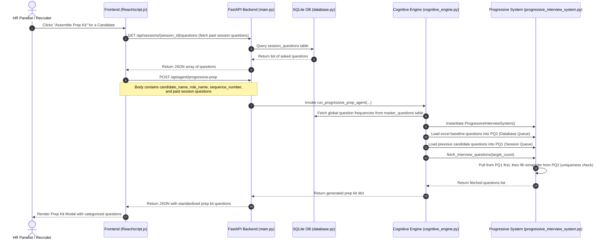

# Progressive Prep Agent (`PROGRESSIVE_PREP_AGENT`) Documentation

The **Progressive Prep Agent** is a key sub-agent in the Protiviti HR Automation Pipeline. Its primary purpose is to dynamically generate and assemble custom interview preparation kits for candidates. By implementing a **priority-queue-driven dynamic selection loop** (via `ProgressiveInterviewSystem`), it ensures that the interview questions become progressively more refined, diverse, and robust as successive candidates undergo screening in a session.

---

## 1. Overview & Data Flow

Below is the Mermaid sequence diagram illustrating the data flow across the frontend, the FastAPI backend routes, the SQLite database, and the Priority Queue system during a session-based prep kit generation.

---

## 2. Core Functionalities

The progressive prep logic executes dynamic question selection using the following rules:

### A. Core Data Structures
1. **PQ1 (Session Queue):** A Max-Priority Queue with a strict size limit of 15. It tracks the questions asked to previous candidates in the active interview session.
2. **PQ2 (Database Queue):** An unlimited Max-Priority Queue. It stores all standard database questions loaded from Excel baselines, ordered by highest frequency first.
3. **HashMap (Frequency Registry):** Maps each `question_id` to its overall `ask_count` to maintain accurate frequencies.

### B. Dynamic Selection Loop
1. **Dynamic Target Count:** The number of questions fetched is dynamically managed between 5 and 15 questions based on the candidate queue length:
   $$\text{target\_count} = \max(5, \min(15, \text{len(previous\_questions)} + 3))$$
2. **PQ-Driven Fetching:** 
   * Questions are pulled from **PQ1** (Session Queue) first, ensuring Candidate 2 is asked the questions asked to Candidate 1 to enforce consistency.
   * If PQ1 has fewer than `target_count` questions, the remaining balance is filled using the highest-frequency questions from **PQ2** (Database Queue).
   * Uniqueness is strictly enforced so that a question is never duplicate-added to the same kit.

---

## 3. Strict Constraints & Eviction

The system enforces several boundary conditions and fallback mechanisms to keep sessions moving dynamically:

| Constraint / Safeguard | Rule / Limit | Implementation Detail |
| :--- | :--- | :--- |
| **Minimum Questions** | **Minimum of 5 questions** | If the total questions fetched is $< 5$, `target_count` is automatically padded to 5. |
| **Maximum Questions** | **Maximum of 15 questions** | If the total questions fetched exceeds 15, it is clamped at 15. |
| **Dynamic Eviction** | **Evicts lowest frequency from PQ1** | When PQ1 reaches its limit of 15 questions, adding new questions triggers an eviction. The least-asked (lowest overall frequency) question is popped from PQ1 in $O(N)$ time to make room. |
| **Duplicate Prevention** | **Set-based ID tracking** | Prevents selecting the same question twice if it exists in both PQ1 and PQ2. |

---

## 4. System Integrations & Code Entry Points

The Progressive Prep features interact with multiple entry points in the backend codebase:

1. **Standalone Sub-Agent Endpoint** ([main.py:L485-496](file:///c:/Works/Hiring_Automation_Pipeline/HR_Automation_Pipeline/app/main.py#L485-496))
   *   Route: `/api/agent/progressive-prep`
   *   Triggers the `run_progressive_prep_agent` function and returns the final question payload for the UI.
2. **Assembly Endpoint** ([main.py:L365-374](file:///c:/Works/Hiring_Automation_Pipeline/HR_Automation_Pipeline/app/main.py#L365-374))
   *   Route: `/api/progressive-prep-assembly`
   *   Accepts `historical_questions` and `current_session_questions` lists and merges them.
3. **Accept Candidate Integration** ([main.py:L419-431](file:///c:/Works/Hiring_Automation_Pipeline/HR_Automation_Pipeline/app/main.py#L419-431))
   *   When a candidate is marked as "Accept", the backend generates a confirmation email.
   *   If the recruiter has not assembled a preparation kit manually, the backend automatically calls `run_progressive_prep_agent` behind the scenes to generate baseline questions and embeds them directly in the email's HTML body.
