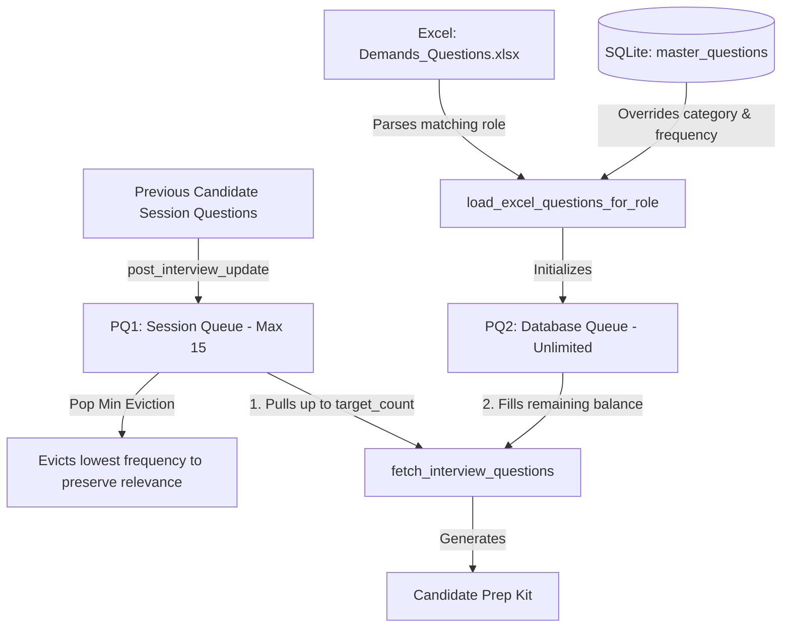

# Interview Questionnaire System: Architecture & Debugging Analysis

This document provides a detailed technical breakdown of the interview questionnaire system in the **Protiviti HR Hiring Portal**, explaining its architecture, category segregation, and the root causes behind the identified issues.

---

## 1. Interview Questionnaire Implementation Walkthrough

The interview questionnaire system is designed to dynamically assemble, deduplicate, and prioritize interview questions for candidates in a sequence. It combines **Excel-based baseline data** with **live session history** using a dual-queue priority architecture.



### A. Core Components
1. **The HashMap Frequency Registry (`frequency_registry`):**
   A dictionary inside [`progressive_interview_system.py`](file:///c:/Works/Hiring_Automation_Pipeline/HR_Automation_Pipeline/app/services/progressive_interview_system.py#L90) mapping `question_id -> overall_ask_count`. It acts as the single source of truth for how many times a question has been asked.
2. **PQ2 (Database Queue):**
   An unlimited max-priority queue (backed by a binary max-heap using negated priorities in Python's `heapq` library). It is initialized with the baseline questions from the Excel file (cross-referenced with the SQLite `master_questions` table to load actual historical frequencies).
3. **PQ1 (Session Queue):**
   A bounded max-priority queue (maximum size of 15) that stores questions asked to previous candidates during the active hiring session. 
4. **Dynamic Eviction:**
   When questions are asked and registered via `post_interview_update()`, their frequencies increment in the registry. If `PQ1` exceeds 15 questions, the lowest-frequency question is evicted (`pop_min()`) to keep the session queue focused on the most relevant, frequently asked questions.

### B. Execution Flow
- **Step 1: Prep Kit Assembly:** When clicking **"Prep Kit"** in the UI, the frontend calls the [`/api/agent/progressive-prep`](file:///c:/Works/Hiring_Automation_Pipeline/HR_Automation_Pipeline/app/main.py#L528) endpoint.
- **Step 2: Fetching Questions:** [`fetch_interview_questions(target_count)`](file:///c:/Works/Hiring_Automation_Pipeline/HR_Automation_Pipeline/app/services/progressive_interview_system.py#L129) constructs the candidate prep kit:
  1. It first retrieves all questions from `PQ1` (ensuring previous candidates' questions carry over).
  2. If the count is less than the `target_count` (which grows by 3 for each candidate in sequence, capped at 15), it pulls the highest-frequency questions from `PQ2` to make up the balance.
- **Step 3: Save Session Questions:** When the interviewer enters questions and clicks **"Send"** in the Collect Questions modal, the questions are saved to the `session_questions` table via [`/api/session-questions/save`](file:///c:/Works/Hiring_Automation_Pipeline/HR_Automation_Pipeline/app/main.py#L689) and passed to the next candidate's prep kit.

---

## 2. Domain vs. Generic Questionnaire Segregation

Segregation occurs at both the **database level** and the **user interface level**:

### A. Database-Level Segregation
- **`master_questions` Table:**
  Contains a `CHECK` constraint: `type TEXT CHECK(type IN ('GENERIC', 'DOMAIN'))`.
  - `"GENERIC"` represents general technical, behavioral, or scenario questions (displayed in yellow).
  - `"DOMAIN"` represents role-specific, transaction banking, or industry-specific questions (displayed in green).
- **`session_questions` Table:**
  Stores live questions under `category = 'General'` or `category = 'Domain'`.

### B. UI-Level Segregation (Filtering)
To remain robust against minor casing variations (e.g. `"Domain"`, `"domain"`, `"DOMAIN"`) or descriptive category labels (e.g., `"Domain Questions"`), the frontend filters categories by checking for the substring `"domain"` case-insensitively:
- **General Column:** Filters out categories containing `"domain"`:
  ```javascript
  const genericQs = prepKitQuestions.filter(q => q && !(q.category || '').toLowerCase().includes('domain'));
  ```
- **Domain Column:** Includes only categories containing `"domain"`:
  ```javascript
  const domainQs = prepKitQuestions.filter(q => q && (q.category || '').toLowerCase().includes('domain'));
  ```

---

## 3. Root Cause Analysis of Core Issues

Below is the detailed debugging analysis explaining the issues you described.

### Issue A: "Consolidated Insights" button at times is not working

There are three primary reasons why the Consolidated Insights functionality fails:

1. **LLM Output Parsing Failure (JSON Schema Mismatches):**
   The consolidation agent [`run_session_consolidation_agent`](file:///c:/Works/Hiring_Automation_Pipeline/HR_Automation_Pipeline/app/services/cognitive_engine.py#L561) invokes an LLM to group, deduplicate, and output structured questions in JSON format using `response_format={"type": "json_object"}`. 
   If the LLM returns an unexpected format, runs out of tokens (truncating the JSON), or produces malformed syntax, the backend crashes at `json.loads(completion.choices[0].message.content)` with a `JSONDecodeError`, returning a **500 Internal Server Error** to the browser.
2. **Missing Input/Empty Session Mismatches:**
   If a session is newly created and has no questions logged yet, or if `master_questions` is empty, the frontend sends empty lists `[]` to `/api/final-consolidation`. This causes the LLM to output empty objects or fall back to plain-text warnings instead of the strict JSON structure required by the parser, causing key-lookup errors.
3. **LLM Timeout/Rate Limits:**
   Since the endpoint relies on an external OpenAI-compatible huggingface endpoint (`openai/gpt-oss-20b`), network timeouts, model cold starts, or API rate limit failures instantly cause the HTTP request to crash.

---

### Issue B: Why questions are not getting saved in the Master DB

1. **Legacy SQLite Syntax Error (Fixed in recent session):**
   Previously, the UPSERT operation in `save_to_master_db` and `run_session_consolidation_agent` was using:
   ```sql
   ON CONFLICT (question_text) DO UPDATE SET frequency = master_questions.frequency + 1;
   ```
   SQLite does not permit qualifying column names with table prefixes inside the `SET` block of an `ON CONFLICT` clause. This raised a `sqlite3.OperationalError: no such column: master_questions.frequency` and blocked all saves.
   *(This was corrected to `frequency = frequency + 1` / `frequency = frequency + ?` respectively).*
2. **Ignored Category/Type Updates on Conflict:**
   If a question already exists in the `master_questions` table (even with a different category type, such as `"GENERIC"`), clicking "Save" on that question under the "Domain Questions" textarea runs the UPSERT clause:
   ```sql
   INSERT INTO master_questions (question_text, type, frequency) VALUES (?, ?, 1)
   ON CONFLICT (question_text) DO UPDATE SET frequency = frequency + 1;
   ```
   Notice that the `DO UPDATE` statement **only increments the frequency** and **does not update the `type` column**. Therefore, if a question is already registered in the database, its category category cannot be changed, and it will fail to save under the new type.
3. **SQLite Concurrent Write Locking:**
   SQLite is a file-based database that locks the entire file during write operations. If the background thread parsing resumes is busy writing, any manual save request will hit a `Database is locked` exception and fail.

---

### Issue C: Why questions are stacked under the Generic column

Even when saved successfully, questions often end up grouped exclusively in the "General Questions" (Generic) column due to category mapping mismatches:

1. **Strict Substring Checking in the UI:**
   As highlighted in Section 2-B, the frontend classifies any category block as "General Questions" unless its category name contains the substring `"domain"` (case-insensitive). 
   If the LLM consolidator groups questions under specific headers (e.g., `"Java Basics"`, `"SQL Queries"`, `"Behavioral"`), none of these contain the word `"domain"`. Thus, the UI filters them into the `genericCats` list, rendering all of them inside the yellow "General Questions" column.
2. **Fallback to `"GENERIC"` on Consolidated Updates:**
   In [`app/main.py`](file:///c:/Works/Hiring_Automation_Pipeline/HR_Automation_Pipeline/app/main.py#L438-L442), when processing updates returned by the consolidator:
   ```python
   existing_cat = master_type_map.get(q_text)
   if not existing_cat:
       existing_cat = "DOMAIN" if "domain" in q_text.lower() else "GENERIC"
   ```
   If the exact string lookup in `master_type_map` fails (e.g., due to minor whitespace or capitalization differences), the backend attempts to categorize the question by searching for the word `"domain"` **in the question text itself** (`q_text.lower()`).
   Because actual questions (e.g., *"How do you handle messaging queues?"*) almost never contain the word `"domain"`, they default to `"GENERIC"` and get stacked under General.
3. **Baseline Excel Parsing Defaults:**
   If the baseline parser (`load_excel_questions_for_role`) fails to classify a question, it defaults its category to `"General"`. Once saved in the session database under `"General"`, it is pulled into subsequent candidate prep kits with that label.

---

## 4. Proposed Core Solutions (For Future Reference)

To address these bugs, the following corrections should be implemented in the future:
- **Update the SQLite UPSERT clause** to update both frequency and type:
  ```sql
  ON CONFLICT (question_text) DO UPDATE SET frequency = frequency + 1, type = excluded.type;
  ```
- **Ensure the LLM strictly groups** into category names containing the literal word `"Domain"` or `"General"`.
- **Refactor the fallback category check** in `api_final_consolidation` to use semantic checks instead of searching for the string `"domain"` inside the question text.
